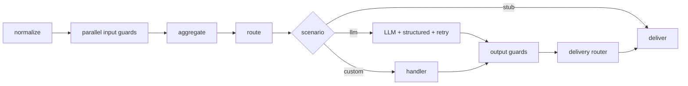

# @kir-str/llm-gateway

> **Early stage.** The public API may still change before `1.0.0`. Breaking changes will be
> called out in the package README / changelog, not silently introduced.

A config-driven LLM turn-processing pipeline, packaged as a library rather than a service.
You embed `@kir-str/llm-gateway` in your own Node/edge/browser process, hand it a config and a
handful of adapters (an `LlmCaller`, a `TelemetrySink`, ...), and call `runTurn(input)` for each
turn of a conversation. The gateway runs input guards, routes to a scenario, calls the LLM with
retry and structured-output handling, runs output guards, and hands back a result — emitting a
telemetry event at every step.

The package has no server, no process boundary, and no LLM provider SDK in its dependencies —
the pipeline logic is separate from how you call a model or where you send telemetry.

## Pipeline



## Quick start

See [`examples/minimal`](examples/minimal) for a runnable end-to-end example: a neutral YAML
config, a fake `LlmCaller`, and a console `TelemetrySink` running two turns (a normal reply, and
a PII short-circuit).

```bash
pnpm install
pnpm -w build
pnpm -C examples/minimal start
```

Minimal usage sketch:

```ts
import { createGateway } from '@kir-str/llm-gateway';
import { loadConfigFile } from '@kir-str/llm-gateway/node';

const config = loadConfigFile('./gateway.config.yaml');
const gateway = createGateway(config, { llm, telemetry });

const result = await gateway.runTurn('Hello, how are you?');
console.log(result.outcome, result.text);

await gateway.close();
```

See [`packages/gateway/README.md`](packages/gateway/README.md) for the `Guard` contract, the
full config format, and the telemetry event dictionary.

## Packages

- [`packages/gateway`](packages/gateway) — the `@kir-str/llm-gateway` package (entries `.` and
  `./node`).
- [`examples/minimal`](examples/minimal) — end-to-end runnable example.

## License

MIT — see [LICENSE](LICENSE).
